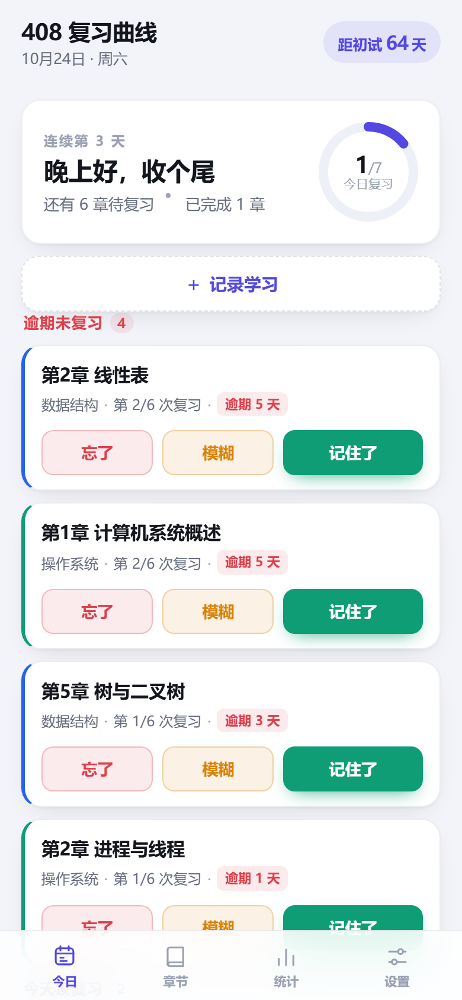
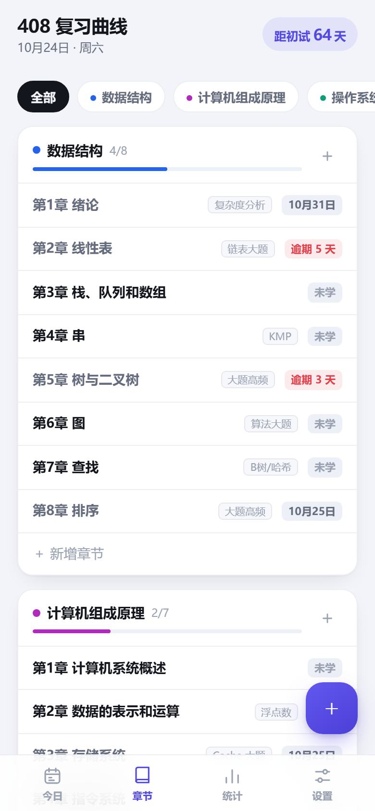
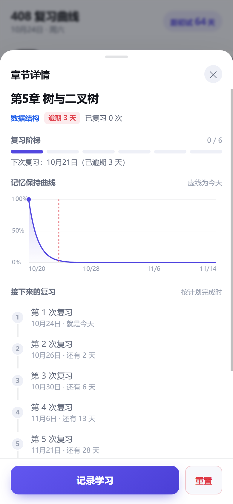

# 408 复习曲线

考研 408 的章节学习记录 + 艾宾浩斯遗忘曲线复习计划。手机浏览器打开就能用，数据存在本机。

  

更多截图见 `docs/`：记录面板、统计、设置、考前冲刺、深色模式、首次使用。

## 一分钟用起来

**方式一：电脑上开个本地服务，手机连同一个 Wi-Fi 访问**（推荐，能用上离线缓存和"添加到桌面"）

```powershell
cd D:\408-review
node serve.js
```

终端会打印两个地址：

```
电脑打开:  http://localhost:8080
手机打开:  http://192.168.x.x:8080
```

手机浏览器打开那个 `192.168.x.x` 的地址，然后：

- **安卓 Chrome**：菜单 →「添加到主屏幕」
- **iPhone Safari**：分享按钮 →「添加到主屏幕」

之后从桌面图标打开，就是全屏无地址栏的 App 样子。

**方式二：直接把 index.html 拖进浏览器**

双击 `D:\408-review\index.html` 也能用（功能完整），但没有离线缓存、不能添加到桌面。适合先在电脑上试。

> 如果手机打不开，多半是 Windows 防火墙拦了。第一次运行 `node serve.js` 时系统会弹窗，选「允许访问」。

## 每天怎么用

1. 学完一章，点首页的 **＋ 记录学习**，选科目和章节（可多选），挑个熟练度，记下来
2. 系统按 1/2/4/7/15/30 天自动排复习
3. 第二天起，「今日」页会列出来该复习什么

三个按钮的意思：

| 按钮 | 效果 |
|---|---|
| 记住了 | 进入下一档，间隔拉长 |
| 模糊 | 停在原档，同样间隔再来一次 |
| 忘了 | 退回第一档，明天重新复习 |

逾期了不用管，从你实际完成的那天重新算。

## 功能

- **408 四科 26 章预置**（王道目录），也能自己加章节
- **今日页**：逾期 / 今天该复习 / 考前冲刺 / 今日新学，一键打分
- **章节页**：分科进度、每章状态和下次复习日期
- **统计页**：已学/已掌握/累计复习/连续打卡、近 14 天活动、分科进度、复习 vs 不复习的曲线对比
- **章节详情**：复习阶梯、记忆保持曲线、接下来的复习安排、完整历史（可撤销）
- **考前冲刺**：初试前 N 天，把所有学过的章节再过一遍
- **数据**：纯本地存储，支持导出/导入 JSON 备份

## 设置

「设置」页可以改：

- 初试日期（默认 2026-12-27，用于倒计时和冲刺）
- 考前冲刺天数（默认 10 天）
- 复习间隔（默认 `1,2,4,7,15,30`，改完会立刻重算所有章节）
- 每日目标、深浅色主题

## 数据在哪

存在浏览器的 localStorage 里，键名 `kaoyan408.curve.v1`。

**不会上传到任何地方。** 但清浏览器数据、换手机、重装都会丢，建议每周去「设置 → 导出备份」存一份 JSON。

## 文件结构

```
D:\408-review\
├─ index.html            页面骨架
├─ styles.css            样式（深色自适应）
├─ app.js                界面逻辑
├─ scheduler.js          排程核心（纯函数，可单测）
├─ serve.js              本地静态服务器（零依赖）
├─ sw.js                 离线缓存
├─ manifest.webmanifest  PWA 配置
├─ data/chapters.js      408 章节预设
├─ icons/                图标
├─ test/                 单元测试
└─ docs/                 GitHub 同类项目调研
```

## 跑测试

```powershell
cd D:\408-review
node test/scheduler.test.js
```

覆盖：日期计算、阶梯推进、三档反馈、逾期重算、日志乱序回放、队列筛选、连续打卡、曲线生成。

## 改了文件之后

浏览器会用 Service Worker 缓存旧版本。改完 `index.html` / `styles.css` / `app.js` 后，把 `sw.js` 第一行的版本号加一：

```js
var CACHE = 'kaoyan408-v2';
```

再刷新页面，新版本才会生效。

## 说明

- 复习点是经典艾宾浩斯复习点（学完当天算第 0 天，之后第 1/3/7/14/29/59 天），不是精确到分钟的记忆模型
- 熟练度选「熟练」的章节，首复习间隔从 2 天起（跳过第 1 天）
- 这是自用工具，没有账号、没有云同步、没有多设备